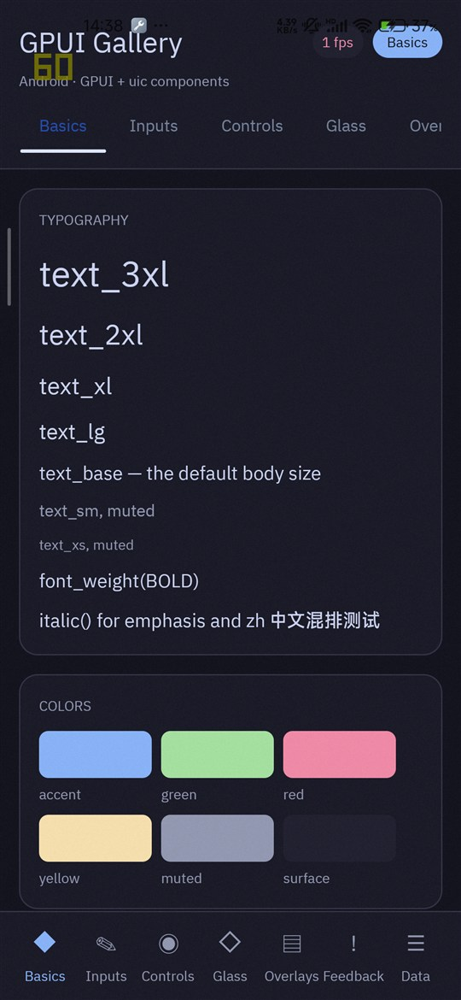
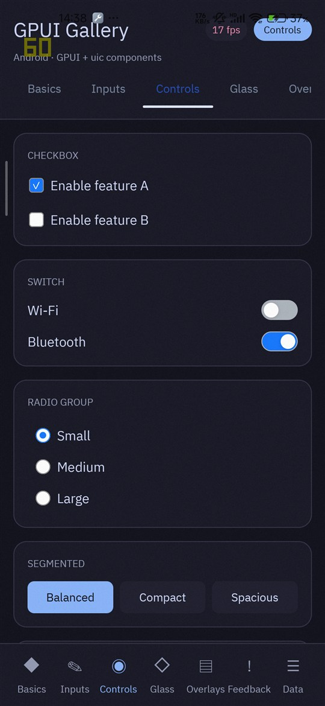
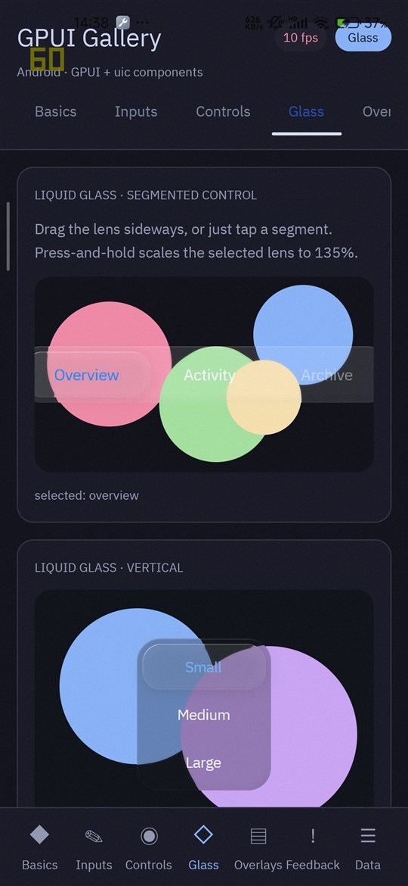
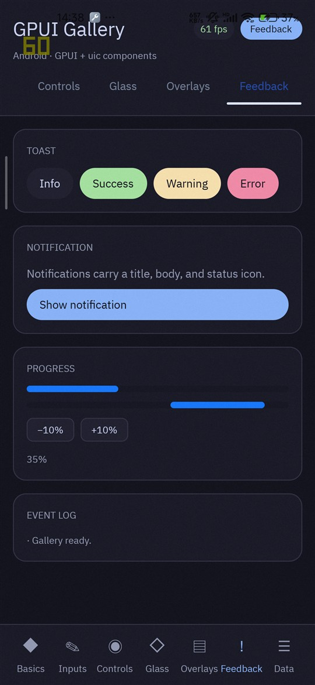
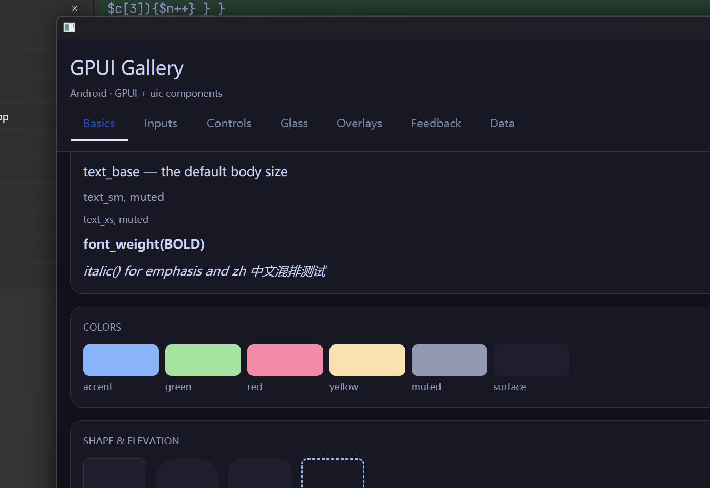

# GPUI Android Gallery

> **想上手玩一下？不用编译，直接下载现成的包：**
>
> - Android：[**gpui-gallery-android.apk**](https://github.com/zcg/gpui-android-gallery/releases/latest/download/gpui-gallery-android.apk)（通用包，arm64-v8a 和 x86_64 都在里面，真机与模拟器都能装）
> - Windows：[**gpui-gallery-windows-x64.exe**](https://github.com/zcg/gpui-android-gallery/releases/latest/download/gpui-gallery-windows-x64.exe)（双击运行，无需安装）
>
> APK 用 Android debug 证书签名，安装时系统会提示“未知来源”，允许即可。
> 所有历史版本见 [Releases](https://github.com/zcg/gpui-android-gallery/releases)。

一个跑在 Android 上的 GPUI 组件展示应用。它把 [`gpui-fusion`](https://github.com/cradiy/gpui-fusion)
里可用的控件和视觉效果集中到七个页面里，用来在真机上手感体验、对照渲染效果、观察帧率。

### 界面预览

真机（1080×2340）上的四个页面：

| Basics | Controls | Glass | Feedback |
| :---: | :---: | :---: | :---: |
|  |  |  |  |

桌面端（可以正常使用，界面按手机竖屏比例排版）：



这个仓库不包含 GPUI 本身，只包含应用层代码（约 1600 行 `src/main.rs`），
通过 [`gpuiforge`](https://github.com/cradiy/gpuiforge) 生成 Android 壳工程并构建安装。

---

## 中文

### 这个项目做什么

GPUI 在 Android 上的组件大多只能从文档里了解，改一行看一次效果的成本很高。
这个应用把能用到的控件放到同一份可滑动的界面里，一次安装就能逐个试：

| 页面 | 内容 |
| --- | --- |
| Basics | 字号层级、色板、圆角与阴影、按钮、Badge |
| Inputs | 文本框、密码框、多行输入、数字输入（含步进/范围） |
| Controls | Checkbox、Switch、Radio、分段选择、Slider |
| Glass | Liquid glass 分段控件（水平/垂直）、FrostedGlass 背景模糊、透明度与动效开关 |
| Overlays | Modal 弹窗、Bottom sheet、悬浮卡片 |
| Feedback | Toast 四种状态、Notification、确定/不确定进度条、事件日志 |
| Data | 交替行列表、卡片网格、带日志的计数器 |

顶栏右侧有一个**实时帧率计**：它统计每秒构建的帧数，帧率 ≥55 显示绿色、≥30 黄色、否则红色。
静止时界面不重绘，数字会归零——**滑动屏幕即可看到该页面的真实帧率**。

### 前置要求

- Rust 1.85 或更高（`Cargo.toml` 使用 edition 2024），并安装
  `aarch64-linux-android` / `x86_64-linux-android` target
- Android SDK + NDK
- JDK 17 或更高
- `gpuiforge`：`cargo install --path <gpuiforge 仓库>`

### 第一步：获取源码

GPUI 依赖直接指向官方仓库，不需要额外配置：

```bash
git clone https://github.com/zcg/gpui-android-gallery.git
cd gpui-android-gallery
```

首次构建时 Cargo 会自动拉取 [`gpui-fusion`](https://github.com/cradiy/gpui-fusion)。
具体版本由随仓库提交的 `Cargo.lock` 固定；想跟进上游就执行 `cargo update`。

`gpuiforge.json` 里的 `application-id` 也可以换成你自己的包名。

### 第二步：构建并运行

```powershell
# 检查工具链（JDK / SDK / NDK / 设备）
gpuiforge doctor

# 列出已连接设备及其 ABI
gpuiforge devices

# 构建并安装到设备（推荐 release，原因见下）
gpuiforge run android --release

# 只在宿主机构建，不安装
gpuiforge build android --release

# 多个设备时显式指定
gpuiforge run android --release --device <serial>

# 只构建某一个 ABI（默认跟随设备）
gpuiforge build android --release --abi arm64-v8a
gpuiforge build android --release --abi x86_64

# 桌面版
gpuiforge run desktop --release
```

`gpuiforge` 会在 `target/gpuiforge/android/` 下生成 Gradle 工程，输出 APK 到
`target/gpuiforge/android/app/build/outputs/apk/<debug|release>/`。

### 关于 debug 与 release

**请用 `--release` 构建。**

上游 `gpui-fusion` 的 debug 构建会把 wgpu 的 `DEBUG` 标志打开，从而启用
`VK_EXT_debug_utils`，在部分 Android GPU 驱动（以及模拟器的转译驱动）上会让进程在创建
第一个 GPU adapter 时直接 `SIGSEGV`：

```
F DEBUG : #00 pc ... /vendor/lib64/hw/vulkan.kona.so
                 (vk_common_SetDebugUtilsObjectNameEXT+291)
F libc  : Fatal signal 11 (SIGSEGV), fault addr 0x0
```

release 构建不会设置该标志，因此正常。如果你需要在 debug 下调试，可以把这一处修复
（[cradiy/gpui-fusion#9](https://github.com/cradiy/gpui-fusion/pull/9)）应用到你的
`gpui-fusion` 副本，或自行在 Android 上去掉该标志。

### 前提与已知限制

- Android 与桌面都能运行（桌面不需要 `#[cfg(target_os = "android")]` 那部分代码）。
  界面按手机竖屏设计，因此桌面窗口下排版会显得偏窄。
- 手机横屏下内容会被拉伸或裁切。
- 带玻璃效果的页面（Glass）在 120Hz 屏幕上通常比其它页面更容易掉帧：
  它同时存在三个 backdrop 模糊面板，每个面板都需要独立的渲染 pass。
  60Hz 下实测可以满帧。

### 目录结构

```
src/main.rs       全部界面与状态（七个页面 + 帧率计）
Cargo.toml        依赖与编译档位（debug 下也对热点 crate 开启优化）
gpuiforge.json    Android 构建/运行步骤、包名、ABI
```

### 给 AI 助手的测试指引

想自动验证这个应用，可按下面顺序执行，每一步都可判定成败：

```powershell
# 1. 环境与设备
gpuiforge doctor
gpuiforge devices                     # 记住输出里的 serial 和 ABI

# 2. 构建安装（用设备对应的 ABI，避免走 ARM 转译）
gpuiforge build android --release --abi <arm64-v8a|x86_64>
gpuiforge run android --release --device <serial>

# 3. 启动是否成功（进程存在 + 选中了 GPU + 无崩溃）
adb -s <serial> shell pidof com.example.myapp
adb -s <serial> logcat -d | Select-String "Selected GPU adapter|FATAL|SIGSEGV"

# 4. 画面是否渲染（有内容则颜色数明显大于一个纯色值）
adb -s <serial> exec-out screencap -p > shot.png

# 5. 交互是否生效（切换底部页签后截图应有明显差异）
adb -s <serial> shell input tap <x> <y>
```

阅读帧率时注意两点：

- 顶栏帧率计只在重绘时更新，必须**模拟滑动**（`adb shell input swipe`）才能读到该页面的数值。
- `dumpsys SurfaceFlinger --latency <layer>` 在多数设备可用，但 Android 15 的部分
  ROM（例如 MuMu 模拟器）只返回刷新周期、不返回逐帧时间戳，此时以界面上的帧率计为准。

---

## English

### What this is

A GPUI component gallery that runs on Android. It gathers the widgets and visual effects
available in [`gpui-fusion`](https://github.com/cradiy/gpui-fusion) into seven pages so the
touch behaviour, rendering, and frame rate can be judged on a real device.

### Screenshots

The four pages below are from a phone at 1080×2340; the full row is in the preview section
above, together with a desktop capture.

| Basics | Controls | Glass | Feedback |
| :---: | :---: | :---: | :---: |
|  |  |  |  |

This repository does not contain GPUI itself. It is only the application layer
(~1600 lines in `src/main.rs`), built and installed through
[`gpuiforge`](https://github.com/cradiy/gpuiforge), which generates the Android host project.

### Pages

| Page | Contents |
| --- | --- |
| Basics | Type scale, palette, radii and shadows, buttons, badges |
| Inputs | Text, password, multiline, and numeric fields (with step and range) |
| Controls | Checkbox, switch, radio group, segmented control, slider |
| Glass | Liquid glass segmented control (horizontal and vertical), frosted-glass backdrop blur, transparency and motion toggles |
| Overlays | Modal, bottom sheet, elevated card |
| Feedback | Toasts in four states, notification, determinate and indeterminate progress, event log |
| Data | Alternating list rows, card grid, counter with log |

The header carries a live frame counter: it counts frames built per second and colours itself
green at ≥55, yellow at ≥30, red below. A static screen does not redraw, so the number falls to
zero — **scroll the page to read that page's real frame rate**.

### Requirements

- Rust 1.85 or newer (the manifest uses edition 2024) with the
  `aarch64-linux-android` / `x86_64-linux-android` targets installed
- Android SDK and NDK
- JDK 17+
- `gpuiforge`: `cargo install --path <gpuiforge checkout>`

### Step 1: get the source

The GPUI dependency points at the upstream repository, so nothing needs to be configured:

```bash
git clone https://github.com/zcg/gpui-android-gallery.git
cd gpui-android-gallery
```

Cargo fetches [`gpui-fusion`](https://github.com/cradiy/gpui-fusion) on the first build. The
exact revision is pinned by the committed `Cargo.lock`; run `cargo update` to follow upstream.

You may also change `application-id` in `gpuiforge.json` to your own package name.

### Step 2: build and run

```powershell
gpuiforge doctor                     # check JDK / SDK / NDK / devices
gpuiforge devices                    # list devices with their ABIs
gpuiforge run android --release      # build, install, launch
gpuiforge build android --release    # build only
gpuiforge run android --release --device <serial>   # pick a device explicitly
gpuiforge build android --release --abi arm64-v8a   # single ABI
gpuiforge build android --release --abi x86_64

gpuiforge run desktop --release                     # desktop build
```

The generated Gradle project lands in `target/gpuiforge/android/`, and the APK in
`target/gpuiforge/android/app/build/outputs/apk/<debug|release>/`.

### Use release, not debug

Upstream `gpui-fusion` enables wgpu's `DEBUG` instance flag in debug builds, which adds
`VK_EXT_debug_utils` and names every Vulkan object. Several Android GPU drivers — including the
translated driver used by emulators — crash inside that entry point while the first adapter is
being created:

```
F DEBUG : #00 pc ... /vendor/lib64/hw/vulkan.kona.so
                 (vk_common_SetDebugUtilsObjectNameEXT+291)
F libc  : Fatal signal 11 (SIGSEGV), fault addr 0x0
```

Release builds do not set the flag, so they run normally. To debug on device, apply
[cradiy/gpui-fusion#9](https://github.com/cradiy/gpui-fusion/pull/9) to your checkout, or drop
the flag yourself on Android.

### Scope and known limits

- Runs on both Android and desktop; the desktop build simply omits the
  `#[cfg(target_os = "android")]` code. The layout targets a phone in portrait, so it looks
  narrow in a desktop window.
- On a phone in landscape the content stretches or clips.
- The Glass page is the first to drop frames on a 120Hz panel: three backdrop-blurred panels
  are on screen at once and each needs its own render passes. At 60Hz it holds a full frame.

### Layout

```
src/main.rs       all UI and state (seven pages plus the frame counter)
Cargo.toml        dependencies and build profiles (hot crates stay optimised in debug)
gpuiforge.json    Android build/run steps, package id, ABIs
```

### Notes for an AI agent testing this

Each step below has a pass/fail signal:

```powershell
gpuiforge doctor                                 # toolchain present
gpuiforge devices                                # note the serial and ABI

# Build for the device's own ABI so nothing runs through ARM translation
gpuiforge build android --release --abi <arm64-v8a|x86_64>
gpuiforge run android --release --device <serial>

adb -s <serial> shell pidof com.example.myapp    # process alive => launched
adb -s <serial> logcat -d | Select-String "Selected GPU adapter|FATAL|SIGSEGV"
adb -s <serial> exec-out screencap -p > shot.png # non-trivial colour count => rendered

adb -s <serial> shell input tap <x> <y>          # screenshot should change visibly
```

Two things to know when reading frame rate:

- The header counter only advances while frames are produced, so drive it with
  `adb shell input swipe` rather than reading a static screen.
- `dumpsys SurfaceFlinger --latency <layer>` works on most devices, but some Android 15 builds
  (MuMu emulators among them) return only the refresh period without per-frame timestamps. In
  that case trust the in-app counter.

## Licence

MIT. GPUI and `gpui-fusion` carry their own licences; see those repositories.
